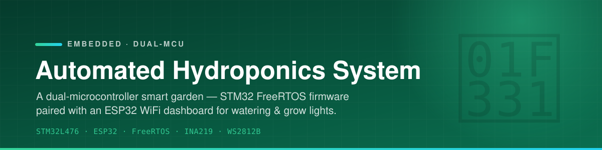
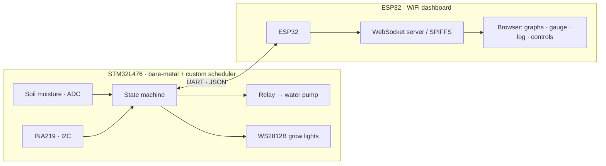

<p align="center">
  
</p>

<p align="center">
  
  
  
  
  
  
</p>

<p align="center">
  A dual-microcontroller smart garden. An <b>STM32L476</b> runs bare-metal firmware on a custom cooperative (time-triggered) scheduler for all
  sensing, pump, and grow-light control; an <b>ESP32</b> hosts a WiFi dashboard with live<br>
  moisture & power graphs, a watering log, and manual controls — talking to each other over UART JSON.
</p>

<p align="center">
  <i>ECE 4380 — Embedded Systems, Texas Tech University · Alex (SlashAlexx) · Dennis Rivera</i>
</p>

---

## ✨ What it does

- 🌱 **Auto watering** — reads a capacitive soil-moisture sensor (ADC) and runs the pump for 2 s
  whenever the soil reads dry.
- 💡 **Addressable grow lights** — drives a WS2812B RGB LED strip via a custom PWM bit-bang driver
  (`ws28xx.c`), with full / dimmed brightness modes.
- ⚡ **Overcurrent protection** — an INA219 power monitor watches grow-light current and flashes an
  error LED if it exceeds 1.5 A.
- 🧵 **Bare-metal firmware + custom scheduler** — a 6-state machine (Init, Auto, Manual, MoistureUpdate, PowerCheck, Tick)
  schedules sensing, control, and UART comms concurrently.
- 🔌 **UART JSON link** — the STM32 streams live readings (`{"MoistureLevel": 84.0}`) and accepts
  commands (`AUTO`, `MANUAL`, `LED_FULL`, `LED_DIM0`, `PUMP_ON`, `PUMP_OFF`).
- 📊 **WiFi dashboard** — the ESP32 serves a WebSocket dashboard from SPIFFS: rolling moisture &
  LED-power charts, a color-gradient moisture gauge, a timestamped watering log, and manual buttons.

## 🏗 Architecture



## 🔌 Hardware

| Component | Detail |
| --------- | ------ |
| Control MCU | STM32L476RGTx (ARM Cortex-M4) |
| WiFi MCU | ESP32 |
| Moisture sensor | Capacitive soil-moisture sensor (ADC) |
| Power monitor | INA219 (I2C) — grow-light current / voltage |
| Pump | Water pump via relay (GPIO) |
| Grow lights | WS2812B addressable RGB LED strip |
| Link | STM32 → ESP32 over UART (JSON packets) |

## 🗂 Layout

```text
src/
├── STM32/   # STM32L476 firmware (STM32CubeIDE) — custom cooperative scheduler (rtos.c), sensors, pump, WS2812B driver
└── ESP32/   # ESP32 sketch — WiFi, WebSocket server, SPIFFS dashboard (HTML/CSS/JS)
```

## 🚀 Quickstart

**STM32 firmware**
```text
1. Open src/STM32 in STM32CubeIDE.
2. Build for the STM32L476RGTx target.
3. Flash over ST-Link.
```

**ESP32 dashboard**
```text
1. Open src/ESP32 in Arduino IDE / PlatformIO.
2. Set your WiFi SSID + password.
3. Upload the SPIFFS dashboard assets, then flash the sketch.
4. Browse to http://<ESP32-IP>/ on the same network.
```

Wire the STM32 ⇄ ESP32 UART (TX/RX + common ground) and power both rails before running.

## 🧰 Stack

| Layer | Tech |
| ----- | ---- |
| Firmware | C, custom cooperative scheduler, STM32 HAL (STM32CubeIDE) |
| Connectivity | ESP32, WiFi, WebSocket, SPIFFS |
| Sensing | Capacitive moisture (ADC), INA219 (I2C) |
| Actuation | Relay-driven pump, WS2812B grow lights |
| Dashboard | HTML / CSS / JavaScript (served from ESP32) |
